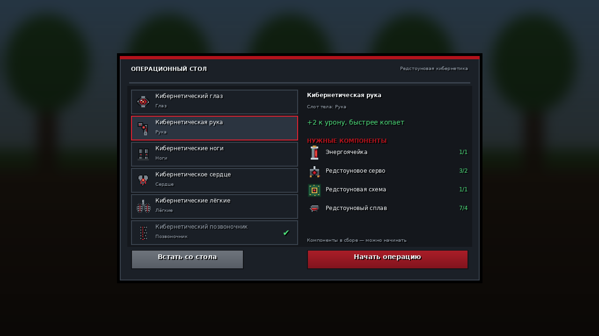
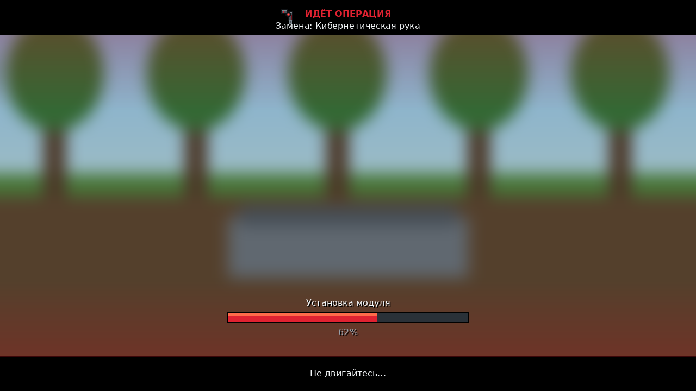
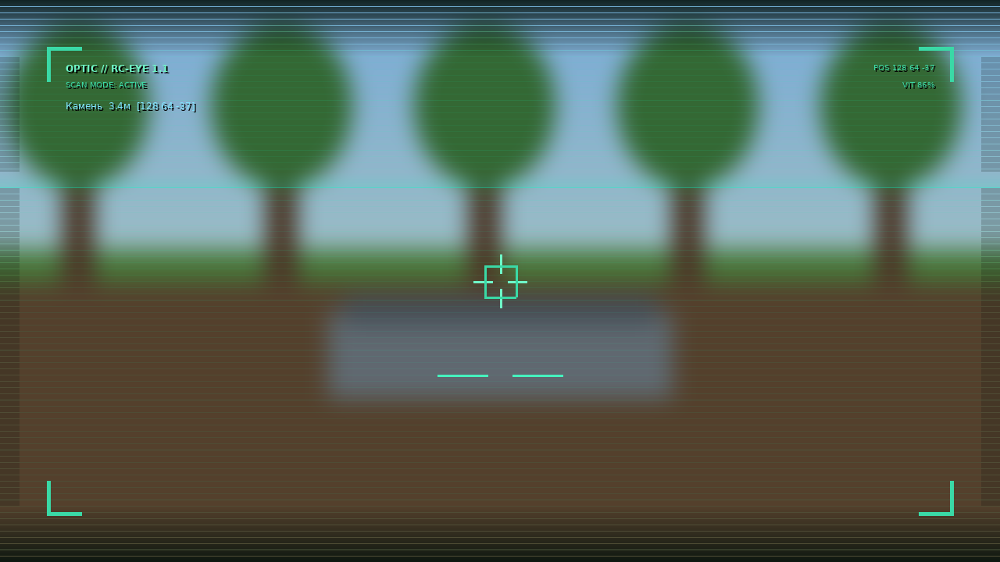
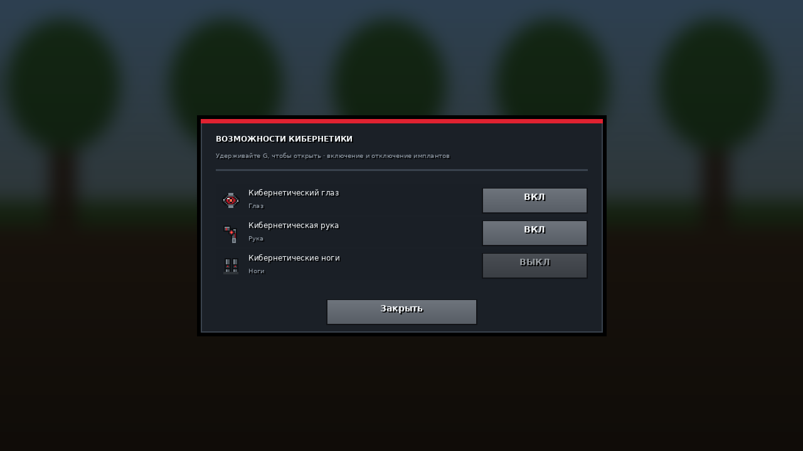

# Redstone Cybernetics — кибернетика на редстоуне (Fabric 1.21.1)

[](https://github.com/SankarhopF/redstone-cybernetics/releases/latest/download/redcyber-1.1.0.jar)
[](https://www.minecraft.net)
[](https://fabricmc.net)
[](https://modrinth.com/mod/playeranimator)



Мод добавляет **кибернетические части тела из редстоуна**, редстоуновые компоненты для них
и **операционный стол**: нажимаете на стол — персонаж ложится, включается **фиксированная камера
операции** (со стороны ног, слева и чуть выше, смотрит на пациента), открывается меню
с **настоящим размытием мира** (сама панель меню остаётся чёткой). В меню выбирается имплант,
показано, какие компоненты нужны и сколько их есть в инвентаре. После подтверждения
проигрывается **анимация замены части тела** (7 секунд: анестезия → разрез → установка модуля →
подключение редстоуновых жил → калибровка), после чего имплант начинает работать.

---

## Что нового в 1.1.0

Итерация сделана по итогам живого теста в игре:

* **Позы и анимации — через мод [PlayerAnimator](https://modrinth.com/mod/playeranimator)**,
  ванильные «дёргания» конечности убраны полностью. Свои эмоуты лежат в
  `assets/redcyber/player_animations/` (`surgery_lying`, `surgery_arm`, `surgery_leg`,
  `surgery_head`), между ними плавные фейды (`AbstractFadeModifier`), а не рывки.
* **Камера операции стала фиксированной и не зависит от взгляда игрока**: миксин в
  `net.minecraft.client.render.Camera#update` каждый кадр ставит камеру со стороны **ножного конца**
  стола, **слева** и **чуть выше**, с прицелом на грудь лежащего. Направление взгляда игрока
  больше ни на что не влияет.
* **Персонаж корректно лежит на одном блоке**: тело принудительно укладывается на поверхность
  стола (`SURFACE_HEIGHT = 14/16`), модель уменьшается до `0.85` и приподнимается, чтобы не свисать
  с блока (`PlayerEntityRendererMixin`).
* **Кибернетический глаз даёт заметные визуальные эффекты зрения**, а не просто ночное зрение:
  визор-оверлей со виньеткой, сканлайнами, бегущей строкой развёртки, уголками-рамками, прицелом
  с пульсирующей меткой и телеметрией (что в прицеле, дистанция, координаты, здоровье).
* **Меню отключения дополнительных возможностей кибернетики** — открывается **удержанием `G`**
  (8 тиков). Список всех установленных имплантов с тумблерами ВКЛ/ВЫКЛ; состояние уходит на сервер
  (`ToggleAbilityC2S`), сохраняется в NBT и влияет и на эффекты, и на attribute-модификаторы.
* Проверены/поправлены рендер и blockstate стола: оба состояния (`lit=false` / `lit=true`) имеют
  полноценные модели, а камера больше не может оказаться внутри геометрии стола — именно это
  и давало эффект «пропавшего» стола во время установки.

---

## 1. Готовый файл

**Скачать:** https://github.com/SankarhopF/redstone-cybernetics/releases/download/v1.1.0/redcyber-1.1.0.jar

```
release/redcyber-1.1.0.jar          ← это и кидаем в mods/
release/redcyber-1.1.0-sources.jar  ← исходники (для IDE)
```
(после `./gradlew build` тот же файл появляется в `build/libs/`)

Требования:

| Что | Версия |
|---|---|
| Minecraft | **1.21.1** |
| Fabric Loader | ≥ 0.16.0 (тестировалось на 0.16.14) |
| Fabric API | **0.116.x + 1.21.1** (обязательно) |
| Java | 21 |
| [PlayerAnimator](https://modrinth.com/mod/playeranimator) | **2.0.4 + 1.21.1** (настоятельно рекомендуется) |

Мод нужен **и на клиенте, и на сервере** (у него есть клиентская часть — меню, анимация, камера).
PlayerAnimator — **мягкая зависимость**: без него мод запускается и работает, но персонаж просто
лежит в базовой позе без плавных анимаций операции (в логе будет `recommends playeranimator`).

---

## 2. Как играть

1. Скрафтите редстоуновые **компоненты** (см. рецепты ниже).
2. Скрафтите **операционный стол**.
3. **ПКМ по столу** → персонаж ложится на стол, камера фиксируется у ножного конца,
   открывается меню.
4. Слева выберите имплант → справа видно: слот тела, эффект, список нужных компонентов
   и наличие (`есть/нужно`, зелёное/красное).
5. **«Начать операцию»** → компоненты списываются, запускается анимация операции.
6. По завершении имплант установлен, персонаж встаёт. **ESC** в меню — встать со стола без операции.
7. **Удержание `G`** в любой момент — меню отключения возможностей кибернетики (тумблеры).

Полезные команды для теста: `/give @s redcyber:cyber_arm`, `/give @s redcyber:power_cell`,
`/give @s redcyber:operating_table`.

---

## 3. Контент мода

### Редстоуновые компоненты (5)

| Предмет | Роль |
|---|---|
| Редстоуновый сплав (`redstone_alloy_ingot`) | каркас импланта |
| Редстоуновая схема (`redstone_circuit`) | логика/проводка сигналов |
| Редстоуновое серво (`redstone_servo`) | «мышца» |
| Нейрочип (`neural_chip`) | стык нервов и редстоуна |
| Энергоячейка (`power_cell`) | питание импланта |

### Кибернетические импланты (6)

| Имплант | Слот | Эффект |
|---|---|---|
| Кибернетический глаз | Глаз | ночное зрение, визор-оверлей (сканирование/телеметрия), +1 блок дальности взаимодействия |
| Кибернетическая рука | Рука | +2 урона, +40% скорость копания, эффективность инструментов +2 |
| Кибернетические ноги | Ноги | +35% скорости, шаг +0.6, безопасное падение +2, прыжок +6% |
| Кибернетическое сердце | Сердце | +3 сердца, регенерация, устойчивость к отбрасыванию |
| Кибернетические лёгкие | Лёгкие | дыхание под водой, запас кислорода, скорость под водой |
| Кибернетический позвоночник | Позвоночник | нет урона от падения, сильная устойчивость к отбрасыванию и взрывам |

Установленные импланты хранятся в NBT игрока (переживают перезаход, смерть и респавн),
эффекты пересчитываются на сервере. Для каждого слота отдельно хранится флаг «возможности
отключены» (меню по удержанию `G`).

---

## 4. Рецепты

Стол:

```
A A A          A = редстоуновый сплав
I R I          I = железный слиток
I . I          R = блок редстоуна
```

Редстоуновый сплав (даёт 1):

```
R R R          R = редстоун
R I R          I = железный слиток
R R R
```

Редстоуновая схема (даёт 2):

```
R Q R          R = редстоун
Q G Q          Q = кварц
R Q R          G = золотой слиток
```

Редстоуновое серво:

```
I A I          I = железный слиток
C P C          A = редстоуновый сплав
I A I          C = редстоуновая схема, P = поршень
```

Нейрочип:

```
R G R          R = редстоун
E C E          G = золотой слиток
R G R          C = редстоуновая схема, E = эндер-жемчуг
```

Энергоячейка:

```
A G A          A = редстоуновый сплав
G R G          G = светокаменная пыль
A G A          R = блок редстоуна
```

Сами импланты **не крафтятся** — только собираются на операционном столе из компонентов:

| Имплант | Стоимость |
|---|---|
| Глаз | энергоячейка ×1, нейрочип ×1, схема ×2, сплав ×4 |
| Рука | энергоячейка ×1, серво ×2, схема ×1, сплав ×4 |
| Ноги | энергоячейка ×1, серво ×4, схема ×2, сплав ×6 |
| Сердце | энергоячейка ×1, нейрочип ×2, схема ×2, сплав ×6 |
| Лёгкие | энергоячейка ×1, схема ×2, серво ×2, сплав ×4 |
| Позвоночник | энергоячейка ×1, нейрочип ×2, серво ×2, сплав ×4 |

---

## 5. Какие моды задействованы

**Обязательный только один: Fabric API.** Второй мод — **PlayerAnimator** — используется для поз
и анимаций операции (мягкая зависимость, без него мод работает, но без анимаций).

| Задача | Решение в моде | Внешний мод? |
|---|---|---|
| «Персонаж ложится» | серверная поза `EntityPose.SWIMMING` + фиксация позиции каждый тик (`PlayerEntityMixin`) | нет |
| Анимация операции (плавная, без дёргания) | эмоуты PlayerAnimator (`assets/redcyber/player_animations/*.json`) + `ModifierLayer<IActualAnimation>` с фейдами | **PlayerAnimator 2.0.4+1.21.1** |
| Масштаб/посадка модели на стол | `PlayerEntityRendererMixin` (`setupTransforms`: `scale(0.85)`, подъём на `0.16`) | нет |
| Камера операции | миксин в `Camera#update` (`CameraMixin`): позиция и поворот считаются от оси тела, взгляд игрока игнорируется | нет |
| Меню с замутнением фона | ванильный post-effect `Screen#applyBlur` (как у меню паузы) — блюрится мир, панель чёткая | нет |
| Визор кибернетического глаза | `HudRenderCallback` (`CyberEyeOverlay`): виньетка, сканлайны, развёртка, прицел, телеметрия | нет |
| Меню тумблеров по удержанию | `KeyBindingHelper` + `ClientTickEvents` (`ModKeybinds`, удержание 8 тиков) + `AbilityScreen` | нет |
| Синхронизация тумблеров | `ToggleAbilityC2S` / расширенный `SyncCyberS2C` (`CustomPayload`, Fabric API) | нет |
| Хранение имплантов и флагов | миксин в `PlayerEntity` + NBT (`writeCustomDataToNbt`) | нет |
| Сеть | `CustomPayload` + `ServerPlayNetworking`/`ClientPlayNetworking` из Fabric API | нет |

> Если PlayerAnimator не установлен, клиент не грузит его классы вообще
> (`AnimationBridge` проверяет `FabricLoader.isModLoaded("playeranimator")`), поэтому краша нет.

---

## 6. Превью интерфейса

**Меню операционного стола** — слева список имплантов (галочка = уже стоит), справа слот тела,
эффект, нужные компоненты с наличием `есть/нужно` и кнопка операции. Фон — настоящий блюр мира,
панель чёткая.


**Анимация операции** — кинематографические полосы, прогресс, фазы, искры редстоуна;
мир при этом виден, камера фиксирована у ножного конца стола и смотрит на лежащего персонажа.



**Визор кибернетического глаза** — сканлайны, развёртка, прицел с меткой цели и телеметрия
(блок/существо в прицеле, дистанция, координаты, здоровье). Это не ночное зрение: картинка
ощутимо «оптическая».



**Меню тумблеров (удержание `G`)** — каждый установленный имплант можно включить или выключить,
состояние сохраняется на сервере.



> Это отрендеренные макеты по реальным координатам из кода (`tools/make_previews.py`),
> а не скриншоты из игры — фон в игре будет настоящим размытым миром, а на столе будет лежать
> ваш персонаж в третьем лице.

---

## 7. Сборка из исходников

```bash
# нужен JDK 21
./gradlew build           # → build/libs/redcyber-1.1.0.jar
./gradlew runClient       # запустить dev-клиент (PlayerAnimator поставить отдельно в mods/)
./gradlew runServer       # запустить dev-сервер
```

Проект проверен: `gradle build` проходит, dev-сервер стартует и грузит мод
(в логе: `Redstone Cybernetics loaded: 6 cybernetic implants registered`, `Loaded 1296 recipes`),
все четыре эмоута успешно проходят десериализацию PlayerAnimator'а.

### Структура

```
src/main/java/com/redcyber
├── RedCyber.java              точка входа (общая)
├── block/                     OperatingTableBlock (+ BlockEntity, св-во lit)
├── core/                      CyberSlot, CyberPart(s), CyberData, CyberAccess, CyberEffects,
│                              SurgeryManager (серверная логика стола/операции), ModEvents
├── item/                      CyberPartItem, ComponentItem, OperatingTableItem
├── net/ModPackets.java        все S2C/C2S пакеты (включая тумблеры)
├── mixin/PlayerEntityMixin    NBT имплантов/флагов + «лежит и не встаёт» на сервере
├── mixin/client/              CameraMixin (фиксированная камера), PlayerEntityRendererMixin
├── client/                    RedCyberClient, CameraRig, ClientTableState, ClientCyberData,
│   │                          ClientSurgeryState, CyberEyeOverlay, ModKeybinds
│   ├── anim/                  AnimationBridge (проверка наличия мода), CyberAnimations (PlayerAnimator)
│   └── screen/                OperatingTableScreen, SurgeryScreen, AbilityScreen
└── registry/                  предметы, блоки, block entity, творческая вкладка

src/main/resources
├── assets/redcyber/           модели, блокстейты, текстуры, lang ru_ru/en_us,
│                              player_animations/*.json (4 эмоута PlayerAnimator)
├── data/redcyber/recipe/      6 рецептов
└── redcyber.mixins.json

tools/                         генераторы текстур / JSON / превью (Python + Pillow)
```

---

## 8. Технические детали и ограничения

* **Один пациент на стол**: пока стол занят, второй игрок получит сообщение «За этим столом уже кто-то лежит».
* **Поза**: ванильная `SWIMMING` (горизонтальная) как база + эмоуты PlayerAnimator сверху
  (дыхание, поворот головы, плавный подъём заменяемой конечности). Голова направлена туда,
  куда вы смотрели перед нажатием, камера — со стороны ног.
* **Камера**: фиксированная, задаётся константами `BACK_OFFSET / SIDE_OFFSET / HEIGHT_OFFSET /
  AIM_*` в `client/CameraRig.java` — двигать ракурс нужно там, в `Camera#update` их уже не правим.
  После операции перспектива возвращается как была.
* **Удаление импланта** пока не реализовано (ставится один на слот, повторная установка блокируется).
  Логика для снятия уже готова на уровне данных — легко добавить кнопку.
* **Заряд/расход редстоуна** не реализован: энергоячейка — это компонент крафта, а не батарейка,
  которую надо менять. Тоже просто добавляется (поле `charge` в NBT + HUD).
* Мод не ломает ванильные эффекты: все бонусы — это attribute-модификаторы с id вида
  `redcyber:implant_<slot>_<n>`, их видно и можно снять командой. Выключение тумблера снимает
  и модификаторы, и статус-эффекты этого слота.
* Тумблеры по умолчанию на клавише **G**; переназначается в настройках управления
  (категория «Redstone Cybernetics»).

---

## Лицензия

MIT — см. [LICENSE](LICENSE).
